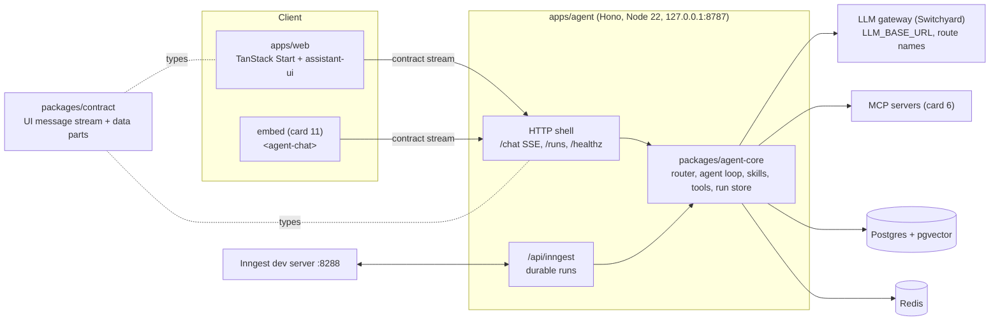

# Architecture

This is the map of the new agentic stack (`apps/`, `packages/`). Read it before you change anything there. The legacy apps (`backend/`, `frontend/`, `web/`, `embed/`, `k8s/`) keep running until the legacy-removal card (PLAN.md §5, card 12). Do not extend them.

Scope is **local development only**: no hosting, deploy or cloud resources. Decisions and their alternatives are recorded in [`docs/adr/`](docs/adr/README.md).

## 1. System

One request: the web app POSTs `/chat` with AI SDK `DefaultChatTransport` body (`chatRequestSchema`). The agent validates it with `validateAgentMessages`. The router picks `{skill, tier, needsResearch, needsPlan}` and emits a `data-route-decision` part. The agent loop then streams text, tool calls and data parts back as an AI SDK UI message stream (SSE). Long goal/research runs go to Inngest and stream progress through the same contract.

## 2. Workspaces and module boundaries

npm workspaces (`apps/*`, `packages/*`) on Node ≥ 22. Each workspace owns `test` and `typecheck` scripts.

| Workspace             | Owns                                                                                                                               | May import                              | Must not                                                                   |
| --------------------- | ---------------------------------------------------------------------------------------------------------------------------------- | --------------------------------------- | -------------------------------------------------------------------------- |
| `packages/contract`   | The wire contract: data part Zod schemas, `AgentUIMessage`, request bodies, fixtures, `CONTRACT_VERSION`                           | `ai` (types/validators), `zod`          | Import any other workspace; contain behaviour beyond validation            |
| `packages/agent-core` | Seams (`Router`, `Skill`, `ToolRegistry`, `RunStore`, `AgentRuntime`, `Principal`), the LLM provider (`createLlm`), the mock model | `contract`, `ai`, `@ai-sdk/*`, `zod`    | Know about HTTP, Hono or React; read `process.env` outside `loadLlmConfig` |
| `packages/ui`         | Instrument Panel tokens (`tokens.ts` = source of truth, `tokens.css` mirrors it), fonts, theme helpers, `cn`                       | `clsx`, `tailwind-merge`, React (peer)  | Import app code or the contract                                            |
| `apps/agent`          | HTTP shell: routing, auth/session, CORS, SSE, Inngest serve handler, process lifecycle                                             | `contract`, `agent-core`, Hono, Inngest | Hold agent logic (keep routes thin), call a provider directly              |
| `apps/web`            | Routes, app shell, panels; vendored shadcn/ui (`components/ui`) and AI Elements (`components/ai-elements`)                         | `contract`, `ui`, React libs            | Import `agent-core` or server code; invent wire types not in `contract`    |

Dependency direction is one way: `contract` ← `agent-core` ← `apps/agent`, and `contract`, `ui` ← `apps/web`. A cycle or a new cross-arrow needs an ADR.

## 3. Where new X belongs

| New thing                                      | Put it in                                                                                                                     |
| ---------------------------------------------- | ----------------------------------------------------------------------------------------------------------------------------- |
| A data part, event or request field            | `packages/contract/src/data-parts.ts` / `requests.ts` + a fixture in `src/fixtures/` + a test. Follow §5                      |
| An HTTP endpoint                               | `apps/agent/src/routes/<name>.ts`, mounted from `app.ts`. Parse with a contract schema                                        |
| Agent behaviour (loop, prompts, approval gate) | `packages/agent-core/src/agent/`, behind `AgentRuntime`                                                                       |
| Router logic (card 5)                          | `packages/agent-core/src/router/`, implementing `Router`                                                                      |
| A tool or MCP client (card 6)                  | `packages/agent-core/src/tools/<tool>.ts`, registered in the `ToolRegistry`; authorise against `Principal`                    |
| A skill / persona (card 6)                     | `packages/agent-core/skills/<name>/SKILL.md` + loader under `src/skills/`                                                     |
| Persistence (threads, runs, facts)             | `packages/agent-core/src/store/` implementing `RunStore`; SQL migrations in `apps/agent/migrations/`                          |
| A durable run / Inngest function (cards 7–8)   | `apps/agent/src/runs/<name>.ts`, appended to `functions` in `inngest.ts`; step logic stays in agent-core                      |
| Configuration / env var                        | The owning `config.ts` Zod schema (`apps/agent/src/config.ts` or `agent-core/src/config.ts`); document it in §6               |
| A design token                                 | `packages/ui/src/tokens.ts` **and** `tokens.css` (the token test enforces parity)                                             |
| A shadcn/ui or AI Elements component           | `npx shadcn add …` from `apps/web` (lands in `components/ui` or `components/ai-elements`); do not hand-edit beyond type fixes |
| An app component or panel                      | `apps/web/src/components/<area>/`, with a `*.stories.tsx` and, if stateful, a `*.test.tsx`                                    |
| A page                                         | `apps/web/src/routes/` (file-based; `routeTree.gen.ts` is generated, commit it)                                               |
| An e2e or screenshot test                      | `e2e/*.spec.ts` (root Playwright config)                                                                                      |
| Metrics/tracing (card 10)                      | `packages/agent-core/src/obs/`; keep the existing Prometheus names                                                            |

If nothing fits, extend the closest existing module. Add a new top-level directory or workspace only with an ADR.

## 4. Code rules

- **File size.** Files stay at or below ~400 lines. `npm run check:loc` enforces it in CI for `apps/`, `packages/` and `e2e/`. Generated files and vendored shadcn/AI Elements copies are exempt. Split by responsibility, not by line count.
- **Models.** Code never names a model. `createLlm(loadLlmConfig()).model(tier)` is the only way to get a `LanguageModel`. Tiers (`fast`, `deep`, `research`) map to gateway route names via `ROUTE_*` env vars. See [ADR 0003](docs/adr/0003-agent-loop-and-models.md).
- **Tests use the mock model.** Set `LLM_PROVIDER=mock` or use `createMockModel()` from `@agent-chat/agent-core/testing`. CI makes no network LLM calls.
- **Fail closed.** Every env var is parsed by a Zod schema at boot. There are no default secrets. Error messages name the variable, never its value. The HTTP error handler never echoes internal details.
- **Security at the tool boundary.** Tools authorise against the caller's `Principal`. Model output never grants permission or extends a skill's `allowedTools`. Consequential tools emit a `data-approval-request` with the real payload and wait.
- **Unit tests** use Vitest next to the code (`*.test.ts[x]`). **E2E** uses Playwright plus `@axe-core/playwright` (WCAG 2.2 AA) in `e2e/`. **Components** get Storybook 10 stories with the a11y addon.
- TypeScript is strict (`tsconfig.base.json`). Workspaces are consumed as TypeScript source (`exports` → `src/*.ts`), so there is no package build step.

## 5. The stream contract

The wire format is the **AI SDK UI message stream** (SSE, `x-vercel-ai-ui-message-stream: v1`). We add nothing outside it. Custom state travels as `data-<name>` parts, validated by `dataPartSchemas`:

| Part               | Purpose                                                                      | Stable id    |
| ------------------ | ---------------------------------------------------------------------------- | ------------ |
| `route-decision`   | Why this skill/tier was chosen (confidence, margin, source, shadow/live)     | `decisionId` |
| `plan`             | Goal plan; each step has a success predicate; `revision` ≤ 3 (replan budget) | `planId`     |
| `step`             | Progress of one step (status, attempt, predicate result)                     | `stepId`     |
| `approval-request` | Human-in-the-loop gate showing the exact payload                             | `approvalId` |
| `citation`         | Claim-level citation with a source excerpt                                   | `citationId` |
| `artifact`         | Versioned canvas artifact; `mcp-app` kinds must use a `ui://` URI            | `artifactId` |
| `handoff`          | Transfer between skills/sub-agents                                           | `handoffId`  |

Write entity parts with the chunk `id` equal to the stable id so the client updates them in place. Message metadata (`messageMetadataSchema`) carries `threadId`, `runId`, `tier` and usage, never a model id. The contract is **frozen at `CONTRACT_VERSION` 1.0.0**: adding an optional field is allowed; any rename, removal, narrowing or new required field needs a new ADR and a version bump. Details: [ADR 0002](docs/adr/0002-stream-contract.md).

## 6. Local runtime

| Command                                            | What it does                                                                                         |
| -------------------------------------------------- | ---------------------------------------------------------------------------------------------------- |
| `npm ci`                                           | Installs every workspace (legacy `backend/`, `frontend/`, `web/`, `embed/` keep separate installs)   |
| `npm run dev`                                      | `compose.dev.yml` up (Postgres+pgvector, Redis, Inngest dev), then agent (`:8787`) and web (`:3000`) |
| `npm run dev:services[:down]`                      | Only the containers                                                                                  |
| `npm run test --workspaces --if-present`           | Vitest in every workspace                                                                            |
| `npm run -w apps/web build && npx playwright test` | Production build + e2e smoke (tokens render, axe clean)                                              |
| `npm run storybook`                                | Storybook on `:6006`                                                                                 |
| `npm run check:loc`                                | 400-line ceiling                                                                                     |

Every port binds to `127.0.0.1`. Postgres uses `trust` auth on loopback (no password to leak).

| Env var                                        | Default                                     | Notes                                                        |
| ---------------------------------------------- | ------------------------------------------- | ------------------------------------------------------------ |
| `LLM_BASE_URL`                                 | `http://localhost:4000/v1`                  | OpenAI-compatible gateway (Switchyard)                       |
| `LLM_API_KEY`                                  | unset                                       | Optional bearer; never logged                                |
| `ROUTE_FAST` / `ROUTE_DEEP` / `ROUTE_RESEARCH` | `local-fast` / `smart` / `smart-frontier`   | Gateway route names, not model ids                           |
| `LLM_PROVIDER`                                 | `gateway`                                   | `mock` for tests/offline                                     |
| `AGENT_HOST` / `AGENT_PORT`                    | `127.0.0.1` / `8787`                        |                                                              |
| `WEB_ORIGIN`                                   | `http://localhost:3000`                     | CORS origin                                                  |
| `INNGEST_DEV`                                  | `http://127.0.0.1:8288` under `npm run dev` | `/api/inngest` mounts only in dev mode or with a signing key |
| `INNGEST_SIGNING_KEY`                          | unset                                       | Required outside dev mode                                    |
| `POSTGRES_PORT` / `REDIS_PORT`                 | `55432` / `56379`                           | Host ports for compose                                       |

## 7. UI

TanStack Start + React 19 + Tailwind v4 + shadcn/ui on Base UI, with `@assistant-ui/react` as the chat runtime (wired to `/chat` in card 4) and shadcn **AI Elements** for agent visuals. The visual direction is **Instrument Panel** (RESEARCH-UI.md §4): graphite `#0B0D0F`, amber `#F5A524` signal, Inter for UI, JetBrains Mono with tabular numerals for traces, 120–260 ms motion that collapses under `prefers-reduced-motion`, and light-theme parity. Light `--accent` is `#9A5B00` (not `#B26B00`) to pass WCAG 1.4.3.

Tailwind utilities follow shadcn semantics so registry components work unmodified: `bg-primary`/`text-signal` are amber, `bg-accent` is the subtle hover surface, and `bg-bg`/`text-fg`/`text-fg-muted` are the Instrument Panel names. See [ADR 0008](docs/adr/0008-ui-stack.md).

## 8. CI

The `new-stack` job in `.github/workflows/ci.yml` runs `npm ci`, `check:loc`, workspace typecheck and tests, the web build, Storybook build and the Playwright smoke. It uses the mock model and needs no services. The legacy jobs are unchanged until card 12.
