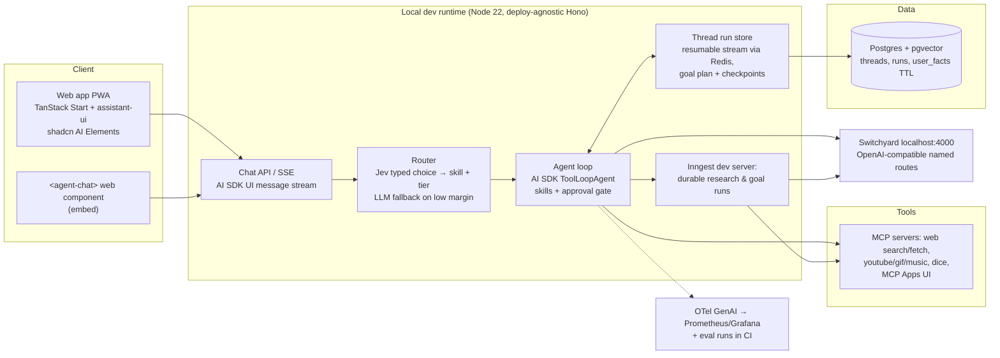

# Example-React-AI-Chat-App — Cleanup + 2026–27 Agentic Modernization Plan

Status: APPROVED 2026-11-13. Scope is **local development only, no hosting/deploy**. Defaults taken: D1 = agentic showcase (entertainment kept as a skill pack), D4 = agent bulk-closes bot issues and stale PRs.

Evidence: `AUDIT.md`, `RESEARCH-AGENTIC.md`, `RESEARCH-UI.md` (same folder; ~130 cited sources, key URLs spot-checked 200 OK, key audit citations re-verified against source).

## 1. Where it is today (verified)

- **What it is:** a 2025 "hold-flow entertainment" demo. 16 persona "agents" in one 1,078-line `config.ts`. Routing is a greeting regex, a keyword table and one `gpt-3.5-turbo` classify call per message (twice on the forced path). The "goal-seeking", validator, RAG and joke-learning systems are decorative `Map`s plus `if`s. The persona agents pin `gpt-3.5-turbo` in 12 places.
- **Streaming is fake:** the full response is re-emitted word by word at 30 ms (`socketHandlers.ts:1095`). All state lives in process memory and is keyed on `socket.id`, so it resets on every reconnect.
- **Health:** CI on `main` has been red since April 2026 (`checks`/`backend`/`embed`). Lint has 6,174 prettier errors. The embed typecheck fails. The backend has 467 tests and the RN frontend has 135, and both pass.
- **Audit:** prod-dependency `npm audit` reports criticals in backend (3) and frontend (2). One of them is `mongoose`, which has zero imports.
- **Hygiene:**
  - `external/` is a stale 3.4 MB vendored copy of the repo itself.
  - There are 11 AI-written `*_COMPLETE/_SUMMARY.md` files, plus `.DS_Store`, `.expo`, `.playwright-mcp`, committed jest JSON and a `.backup` file.
  - The JWT fallback secret `'your_jwt_secret_here'` is hard-coded in `auth.ts:129` and `socketHandlers.ts:316`.
  - About 2,300 LOC of AKS/Flux/Istio/Key Vault infra exists for one demo.
- **GitHub:** 460 open issues. 446 are duplicate bot `[Security] [Dependabot]` issues (71 distinct advisories) and 14 are caretaker/maintainer bot issues; none are real user bugs. There are 9 open PRs, `main` is unprotected, and a dead caretaker bot is still wired in.
- **Three frontends:**
  - Expo RN 0.79 (`frontend/`)
  - Vite + assistant-ui + TanStack (`web/`, the most current)
  - an embed widget, the only surface with a real external consumer
- **Worth keeping:** the `LLMProvider` async-iterable seam, the Redis tiered limiter with transport parity, the anonymous→upgrade identity UX, the `MediaAttachment` union and its renderers, the embed's PKCE flow, the Prometheus metric names, and 4–6 persona prompts as content.

## 2. What changed (2024 → 2026), in one paragraph

Persona-switching plus an intent classifier has been replaced by **one tool-using agent loop with skills** (progressive-disclosure SKILL.md), **sub-agents** for context isolation, and **typed pre-dispatch routing** for cost and model-tier decisions. Tools come in through **MCP**: the stateless 2026-07-28 revision fits serverless, elicitation covers interactive clarification, and **MCP Apps** provide sandboxed generative UI. Long-running "goal-seeking" now means **plans with executable success predicates on durable execution**: checkpoints, replan budget, human-approval interrupts, and steer mid-run. UI ↔ agent is a **typed event stream** (AI SDK UI message stream / AG-UI shape) that is resumable after disconnect. Quality is gated by **trajectory evals plus a prompt-injection suite**. Security moved to the tool boundary: OWASP LLM 2026 lists _excessive agency_ at #3, and MCP tool poisoning is a live risk. Multi-agent "crews" and A2A are mostly hype for a single app (see the honesty section in RESEARCH-AGENTIC.md §7).

## 3. Target architecture (recommended)

**Decisions (with alternatives in the research docs):**

| Area              | Pick                                                                                                                                                                                                         | Why / alternative                                                                                            |
| ----------------- | ------------------------------------------------------------------------------------------------------------------------------------------------------------------------------------------------------------ | ------------------------------------------------------------------------------------------------------------ |
| Language          | TypeScript end to end                                                                                                                                                                                        | One contract across UI, agent and embed. Alternative: Python + Pydantic AI (rejected, splits the stack)      |
| Agent runtime     | Vercel AI SDK (ToolLoopAgent) behind our own thin `agent-core`                                                                                                                                               | Provider-neutral, first-class assistant-ui adapter. Alternatives: Claude Agent SDK harness, Mastra/LangGraph |
| Runtime           | Hono on Node 22, local only; podman compose for Postgres+pgvector, Redis, Inngest dev server                                                                                                                 | No hosting now. Hono keeps a later Workers/serverless move cheap                                             |
| Durable execution | Inngest (local dev server)                                                                                                                                                                                   | RESEARCH-AGENTIC default; step checkpoints + waitForEvent for approvals. Alternative: DBOS (Postgres-only)   |
| Routing           | Typed `choice` decision (TypeSafe Jev) → {skill, model tier, needs_research, needs_plan}. Shadow log first, then live with LLM-router fallback on low margin                                                 | Measured and reversible, per your preference. Replaces regex + keyword + gpt-3.5                             |
| Goal-seeking      | Plan of steps, each with a **success predicate**; checkpoint per step; replan ≤3; approvals for consequential tools; steer/interrupt                                                                         | Replaces the decorative goal-seeking system                                                                  |
| Research          | Plan → parallel search sub-agents (≤2k-token summaries) → read → reflect → claim-level citations                                                                                                             | The "deep research" pattern                                                                                  |
| Models            | App never names a model. `LLM_BASE_URL=http://localhost:4000/v1` (Switchyard) + env-mapped route names (`ROUTE_FAST`, `ROUTE_DEEP`, `ROUTE_RESEARCH`) defaulting to existing routes; mock model for tests/CI | No Switchyard config edits from cards                                                                        |
| Data              | Local Postgres + pgvector (podman compose), `user_facts` with TTL + user-visible delete; Redis for limits + resumable streams                                                                                | Drop Mongo/in-memory maps                                                                                    |
| Tools             | MCP client; port youtube/gif/music/dice as tools; entertainment personas become skills                                                                                                                       | Tool allow-lists instead of prose "deferral"                                                                 |
| Obs/evals         | OTel GenAI spans → existing Prometheus names (~10 metrics); 40–80 golden trajectory cases + injection suite as a CI gate                                                                                     | Drop the Jaeger/Zipkin/GCP triple exporter                                                                   |
| Security          | Authz at the tool boundary with user identity; model output never grants permission; signed anon session; no default secrets; CSP + sandboxed MCP Apps iframes                                               | OWASP LLM 2026                                                                                               |

## 4. UI

- **Stack:** web-first PWA. TanStack Start + React 19 + Tailwind v4 + shadcn/ui (Base UI), with `@assistant-ui/react` as the runtime and shadcn **AI Elements** for agent visuals: Reasoning, Tool, Plan, Queue, Subagent, Confirmation, Sources, Inline Citation, Checkpoint. Scorecard: TanStack Start 4.55 > Next 16 4.05 > RR7 3.55 > SvelteKit 2.65 > Expo 2.55.
- **Drop Expo/RN.** It can't host the desktop-class agent UI (side panels, timelines, MCP App iframes) without forks. Add a Capacitor/Tauri shell later only if a store listing is ever needed.
- **Embed:** `<agent-chat>` web component (Vite lib mode, Shadow DOM) on the same stream contract, keeping the PKCE flow.
- **UX thesis:** design for _delegation_, not dialogue. The core patterns are:
  - a plan checklist and a tool-call timeline
  - "why this agent/route" handoff chips
  - approval cards showing the real payload
  - steer/interrupt mid-run
  - an artifacts/report canvas side panel
  - claim-level citations with source cards
  - branching edits, a ⌘K palette, a status-aware thread sidebar, and mobile bottom sheets
- **Visual direction A, "Instrument Panel" (recommended):**
  - graphite `#0B0D0F` surfaces with an amber `#F5A524` signal accent
  - Inter for UI, JetBrains Mono with tabular numerals for traces and metrics
  - 120–260 ms low motion, compact density, light theme parity
  - the research report canvas uses B's editorial serif ("console for the run, journal for the output")
- **Alternates:** B "Paper Lab" (editorial, citation-first) and C "Aurora Studio" (indigo/cyan, springy). Tokens are in RESEARCH-UI.md §4.
- **Quality gate:** Storybook 10 for components; Playwright `toHaveScreenshot` for all 8 AI states (empty → limits) plus `@axe-core/playwright` (WCAG 2.2 AA) and a reduced-motion path; MSW + mock-model fixtures.

## 5. Delivery plan (cards)

Board `react-chat-app`, project `react-chat-app`. Every GitHub PR goes through IkitClaw App PR → Copilot review → your exact-head approval → gated squash. `main` is unprotected, so cards use `--completion-contract local-only` and the PR gate is enforced by `kanban-pr-review-cycle`.

**Phase 0 — Cleanup (on the current app)**

| #   | Card                              | Deps | Assignee / route        | Acceptance                                                                                                                                                                                                                                                                                           |
| --- | --------------------------------- | ---- | ----------------------- | ---------------------------------------------------------------------------------------------------------------------------------------------------------------------------------------------------------------------------------------------------------------------------------------------------- |
| 1   | Repo hygiene + green CI           | –    | coder-claude / smart-v2 | Deletes `external/`, status docs → `docs/archive/`, junk files; `.worktrees/` ignored; fold #216; fix `docs:spell`, embed TS6133, prettier; drop `mongoose` & dead OTel exporters; remove JWT fallback (fail closed); `npm run lint && npm run type-check && npm test` + web/embed build green in CI |
| 2   | GitHub triage (agent, App writes) | –    | parent session          | 446 dup security issues + 14 bot issues closed with a reason comment; caretaker workflows removed; stale PRs closed/superseded; Dependabot grouped weekly; open issues ≤ ~20 real items                                                                                                              |

**Phase 1 — Modern stack MVP (new layout in the same repo; legacy stays runnable until card 12)**

| #   | Card                                 | Deps | Assignee / route                                          | Acceptance                                                                                                                                                                                                                                                                                         |
| --- | ------------------------------------ | ---- | --------------------------------------------------------- | -------------------------------------------------------------------------------------------------------------------------------------------------------------------------------------------------------------------------------------------------------------------------------------------------- |
| 3   | Architecture lock + scaffold         | 1    | planner-claude / smart-planner                            | `ARCHITECTURE.md` + ADRs, frozen stream/event contract, npm-workspaces `apps/web`, `apps/agent` (Hono server), `packages/{agent-core,ui,contract}`, `compose.dev.yml`, `npm run dev` brings up everything; Tailwind v4 + shadcn + Instrument Panel tokens; Storybook, Vitest, Playwright, CI green |
| 4   | Agent core + streaming + persistence | 3    | coder-claude / smart-frontier-v2                          | Real token streaming via AI SDK UI stream; resume after disconnect (Redis); threads in Postgres; route names only; rate-limit tiers ported; integration test with a mock model                                                                                                                     |
| 5   | Typed router (shadow → live)         | 4    | coder-claude / smart-frontier-v2                          | Jev `choice` → {skill, tier, research, plan}; shadow log table + Prometheus metrics; LLM fallback below the margin threshold; feature flag; eval cases for routing                                                                                                                                 |
| 6   | Skills + MCP tools + media           | 4    | coder-claude / smart-v2                                   | youtube/gif/music/dice as tools; 4–6 personas → skills; MCP client + `<McpAppFrame>` sandbox; MediaAttachment renderers ported                                                                                                                                                                     |
| 7   | Goal-seeking runs + HITL             | 4    | coder-claude / smart-frontier-v2                          | Plan/steps with success predicates, checkpoints, replan ≤3, approval interrupts, steer/cancel; durable across worker restarts (test kills mid-run)                                                                                                                                                 |
| 8   | Deep research agent                  | 7    | coder-claude / smart-frontier-v2                          | plan→search sub-agents→read→reflect→report with claim-level citations; cost/step budget; golden research cases                                                                                                                                                                                     |
| 9   | Agent UI                             | 3, 4 | coder-claude / smart-v2 (2 PRs: shell, then agent panels) | Thread sidebar, composer, reasoning, tool timeline, plan checklist, handoff chips, approval cards, citations, artifacts canvas, ⌘K; 8 AI states screenshotted, axe clean                                                                                                                           |
| 10  | Evals + security + observability     | 5–8  | coder-claude / smart-frontier-v2                          | 40–80 golden trajectory cases + injection suite as a CI gate; OTel GenAI → Prometheus/Grafana dashboard                                                                                                                                                                                            |
| 11  | Embed web component                  | 4, 9 | coder-claude / smart-v2                                   | `<agent-chat>` on the new contract, PKCE kept, demo page, size budget                                                                                                                                                                                                                              |
| 12  | Local integration + legacy removal   | all  | coder-claude / smart-frontier-v2                          | `npm run dev` from clean clone runs full stack against Switchyard; e2e Playwright suite green with mock model; legacy `backend/ frontend/ web/ embed/ k8s/` + Azure/GCS/Flux infra deleted; README/docs ≤8 pages current. No deploy                                                                |

**Later:** hosting (Cloudflare Workers+DO or similar; public demo model access via budgeted route), voice/realtime mode, Capacitor shell, user-memory UI, A2A (only if a second app needs it), learned router once shadow data exists.

## 6. Decisions

- D1 agentic showcase (default). D2/D3: no hosting now; local dev against Switchyard. D4 agent triage (default). Hosting moved to Later.
