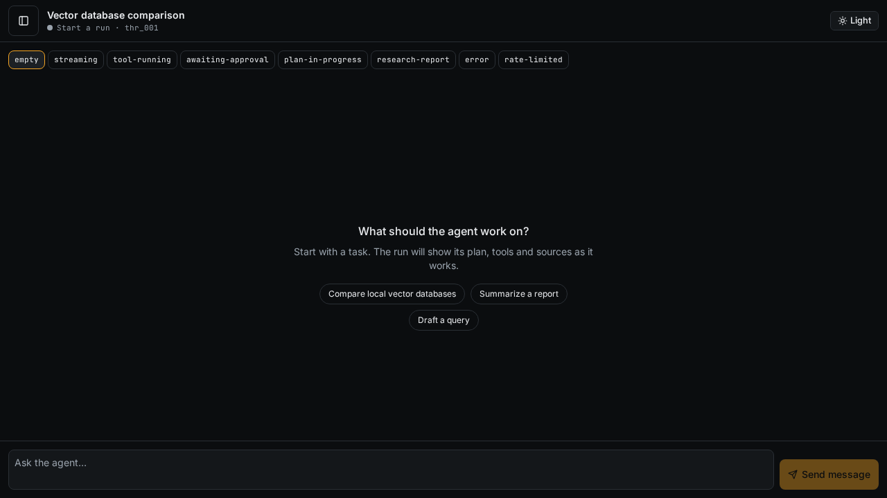
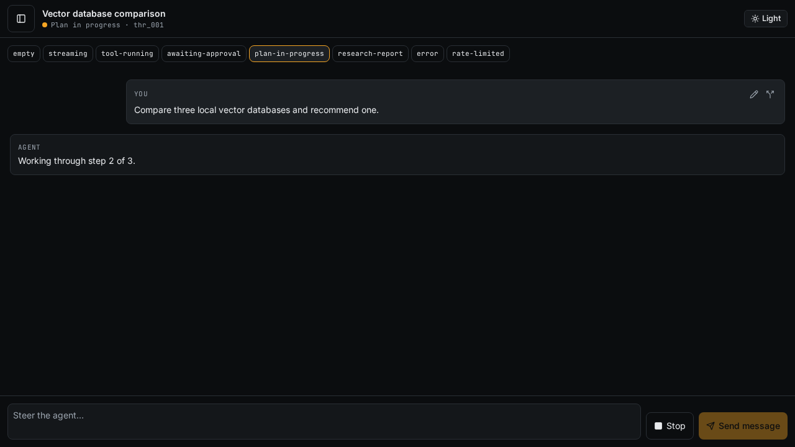
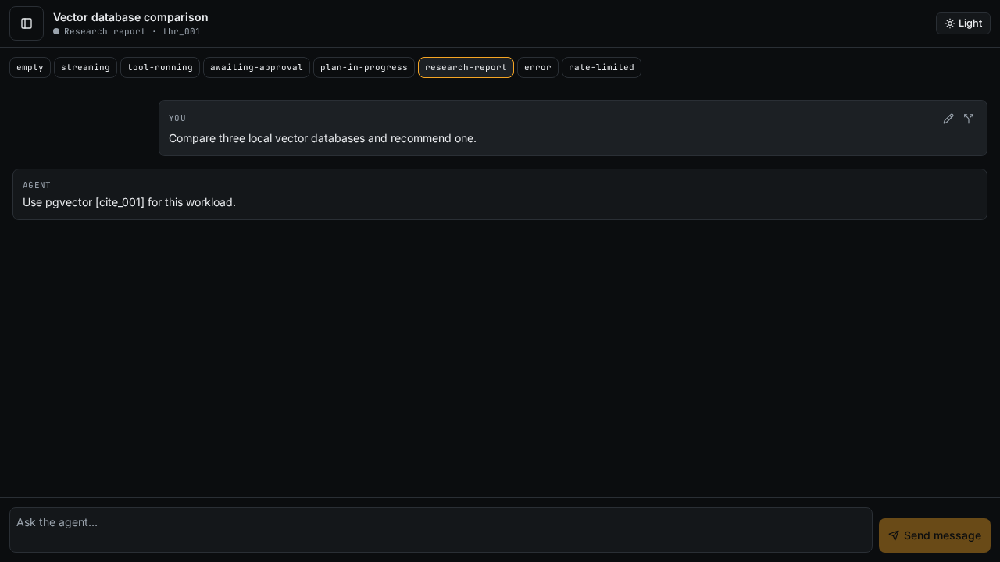

# Agent Chat — local agentic showcase

[](https://github.com/ianlintner/Example-React-AI-Chat-App/actions/workflows/ci.yml)

A local-only demo of a 2026 tool-using chat agent: typed routing, skills, MCP
tools, durable goal/research runs, an Instrument Panel UI, a `<agent-chat>`
web component, golden trajectory evals and an injection suite. TypeScript
end to end. **No hosting or deploy** — everything runs on `127.0.0.1`.

See [ARCHITECTURE.md](ARCHITECTURE.md) for the system map and module boundaries,
[PLAN.md](PLAN.md) for the approved modernization plan, and
[docs/adr/](docs/adr/README.md) for the eight architecture decisions.

## Screenshots

Deterministic Playwright captures of the current UI (regenerated by
`npx playwright test`):







## Quick start

Prerequisites: Node ≥ 22, npm, and Docker or Podman with a `docker` wrapper.
A local [Switchyard](https://github.com/ianlintner/switchyard) gateway on
`http://localhost:4000/v1` supplies the models; tests never call it.

```bash
npm ci
npm run dev
```

`npm run dev` starts Postgres + pgvector, Redis and the Inngest dev server via
`compose.dev.yml`, then the agent on `http://127.0.0.1:8787` and the web app on
`http://127.0.0.1:3000`. Use `npm run dev:services:down` to stop the containers.
The observability stack (Prometheus `:9090`, Grafana `:3001`, OTel collector)
starts with the same command.

Optional env vars (see `apps/agent/.env.example`):

| Variable                                       | Default                                   |
| ---------------------------------------------- | ----------------------------------------- |
| `LLM_BASE_URL`                                 | `http://localhost:4000/v1`                |
| `LLM_API_KEY`                                  | unset (optional bearer, never logged)     |
| `ROUTE_FAST` / `ROUTE_DEEP` / `ROUTE_RESEARCH` | `local-fast` / `smart` / `smart-frontier` |
| `SESSION_SECRET`                               | required at runtime (no default secret)   |
| `LLM_PROVIDER`                                 | `gateway` (`mock` for offline/test)       |

Models are chosen by gateway route name; the app never hard-codes a model id.
Do not edit Switchyard's `routes.yaml` from this repository.

## Verify

```bash
npm ci && npm run lint && npm run typecheck && npm test && npm run eval && npx playwright test
```

`npm run lint` checks formatting and the ~400-line file ceiling. Tests are
Vitest; `npm run eval` runs 48 golden trajectories plus an 18-case injection
suite. The Playwright suite covers the web app (accessibility and all eight AI states); run
`npm run e2e:embed` for the `<agent-chat>` web component. Both use the mock
model, so CI makes no network LLM calls. Run `npm run e2e` for fresh builds and
both suites.

Other useful commands: `npm run build`, `npm run e2e:embed`,
`npm run check:size:embed`, `npm run storybook`, `npm run eval:live` (local
gateway only; never in CI).

## Layout

```
apps/agent          Hono HTTP shell, SSE, durable run endpoints
apps/web            TanStack Start + assistant-ui + AI Elements (web app)
apps/embed          <agent-chat> Shadow DOM web component + demo
packages/contract   frozen UI message stream and data-part schemas
packages/agent-core router, agent loop, skills, tools, stores, mock model
packages/ui         Instrument Panel tokens, fonts, theme helpers
e2e/                Playwright web + embed specs and screenshot baselines
docs/adr/           architecture decision records
```

## Documentation

Current pages: [Architecture](ARCHITECTURE.md), [Plan](PLAN.md),
[ADR index](docs/adr/README.md). Old Expo/AKS/Flux and MkDocs material has been
removed; the history remains in git if needed.

MIT licensed.
